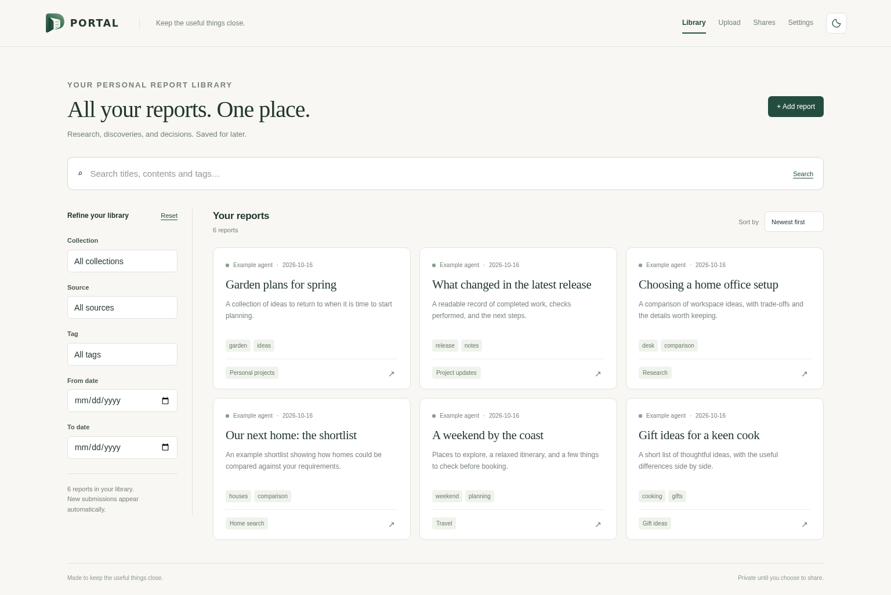
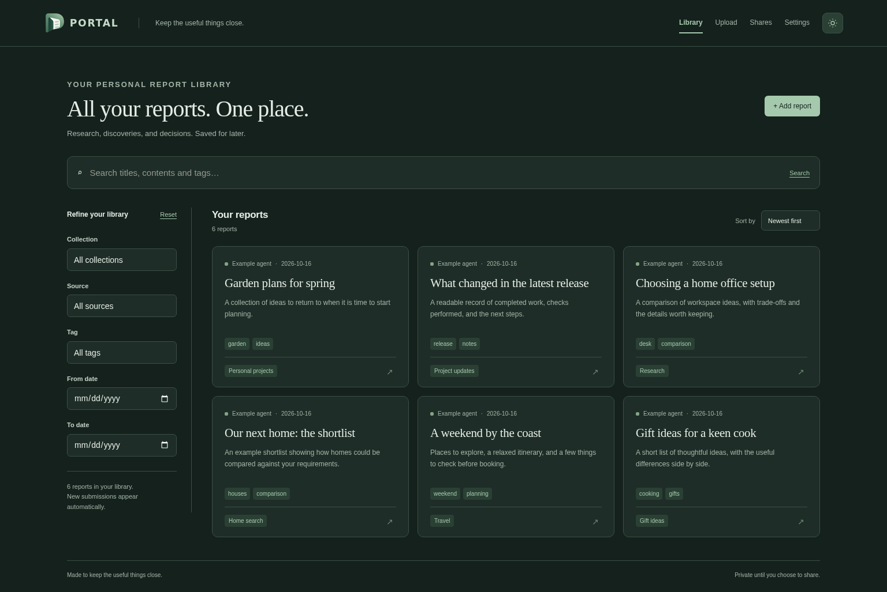
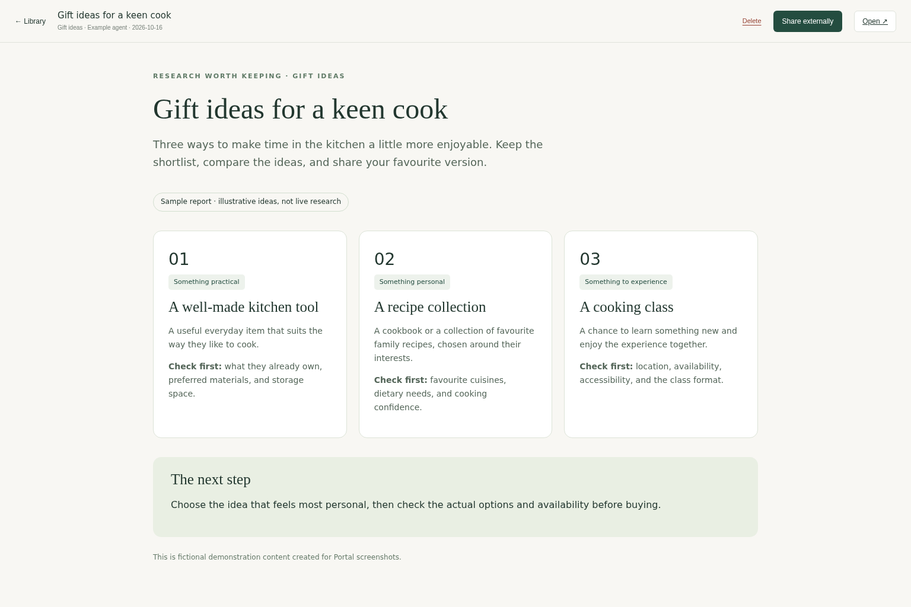
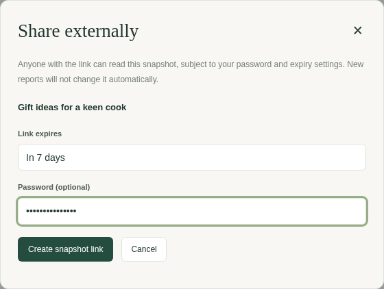

<p align="center">
  
</p>

# A home for the useful things your AI finds.

Portal is a library for HTML reports, running on your own computer or server. Ask an AI agent to create a report, send it to Portal, then browse, search and share it whenever you need it.

> **Inspired by a good friend.** This project was heavily inspired by [Superfishintights](https://github.com/Superfishintights), whose implementation I used as the starting point for my own version. Thank you for the idea and the foundation.



*Screenshots use fictional sample reports.*

## What can you use it for?

Gift shortlists, house searches, travel plans, product comparisons, project updates—anything worth keeping as a readable report instead of losing it in a chat history.

## Features

- **Search and organise:** search report contents and filter by collection, tags, source or date.
- **Upload your way:** add reports in the browser, send them through the API, or use optional watched folders.
- **Revise without clutter:** update an existing report, with a configurable version history.
- **Rich reports:** include images, charts and interactive elements in HTML or ZIP packages.
- **Share on your terms:** create links with optional passwords and expiry dates, and revoke them whenever needed.
- **Controlled snapshots:** update a shared report when you choose, keeping the same link.
- **Light and dark mode:** responsive pages for desktop and mobile.

<details>
<summary>See Portal in dark mode</summary>



</details>

## Using Portal

Choose **Upload**, select an HTML file or ZIP, and click **Import report**. Add a collection and tags to organise it.



To share, open a report and choose **Share externally**. Set an optional password and expiry, then copy the link. Recipients see a snapshot of that report. Use **Shares → Update snapshot / access** when you want to replace it with a newer one.



## Using Portal with AI agents

Copy the API key from **Settings** and give it to your agent with your Portal address. Agents can submit reports from different computers and networks without a shared folder. Using Nexus? The [Portal tool pack](integrations/nexus/README.md) adds report creation, updates, search and sharing tools.

Example request:

> Research gift ideas for someone who enjoys cooking. Create an HTML report comparing the options, with links to your sources, and upload it to my Portal in the “Gift ideas” collection.

### Agent example: send a report with the API

Replace the address with yours and set `PORTAL_API_KEY` to your Settings key:

```sh
curl 'https://portal.example.com/api/reports' \
  -H "X-Api-Key: $PORTAL_API_KEY" \
  -F 'file=@report.html' \
  -F 'topic=Gift ideas' \
  -F 'source=AI agent' \
  -F 'tags=gifts,cooking'
```

For separate assets, send a ZIP with `index.html` at the top and relative links to its files. Each submission creates a new report and returns a private `reader_url`; sharing is a separate action. To revise an existing report, use its **Update** button or the [revision API](docs/reference.md#update-reports). Portal keeps three versions by default, adjustable in Settings. See the [API reference](docs/reference.md#submit-reports) for more options.

## Install with Docker

Requires **Docker and Docker Compose**. Published images support Linux on Intel/AMD 64-bit systems.

**1. Create a Portal folder** and save this as `docker-compose.yml`:

```yaml
services:
  portal:
    image: ghcr.io/dosk3n/portal:latest
    user: "${PUID:-1000}:${PGID:-1000}"
    restart: unless-stopped
    ports:
      - "127.0.0.1:8769:8769"
    environment:
      PUBLIC_BASE_URL: http://localhost:8769
    volumes:
      - ./portal-data:/data
      - ./portal-reports:/storage
```

**2. Start Portal** from that folder:

```sh
mkdir -p portal-data portal-reports
docker compose up -d
```

**3. Open [http://localhost:8769](http://localhost:8769).** Settings are saved in `portal-data`; reports and snapshots are saved in `portal-reports`. For Linux accounts with a different user ID, see [folder permissions](docs/deployment.md#folder-permissions). For a NAS or another disk, see [custom storage](docs/deployment.md#custom-storage).

**Portal has no built-in login.** This example is for local use; remote access needs HTTPS and authentication in front of the app. See the [setup guide](docs/deployment.md).

To update:

```sh
docker compose pull
docker compose up -d
```

## Optional folder imports

Enable folder watching in **Settings** and add a mounted folder. Portal imports completed reports and removes the incoming copy after success. See [folder imports](docs/reference.md#folder-imports) for setup and duplicate handling.

## More help

- [Setup guide](docs/deployment.md) — storage, permissions, remote access, backups and updates.
- [Technical reference](docs/reference.md) — API, packages, sharing, folder imports and source credits.
- For contributors: [architecture](docs/architecture.md) and [validation](docs/validation.md).
